# 三胶着行动 · 网页联机版（DELTA FORCE · WEB OPS）

### ▶ 在线试玩：**https://wzh-game.github.io/Lianjics/** 　（当前版本 **v2.2 · 第三人称视角**）

3D 第一人称战术射击游戏，纯浏览器运行，**单文件、零依赖、无需安装**。
联机采用 **WebRTC DataChannel + 房主权威（host-authoritative）** 架构；v1.9.0 起内置 **游戏内云邮箱**，玩家之间可以互相写信、离线留言。

[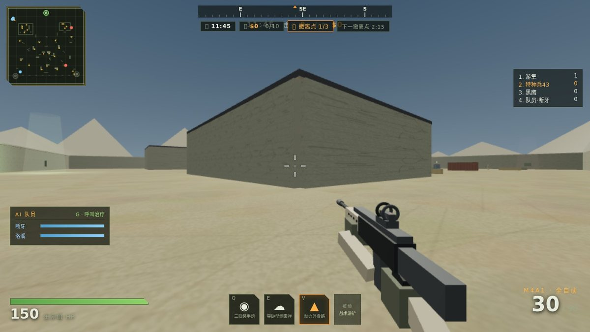](https://wzh-game.github.io/Lianjics/)

---

## ⭐ 本次更新重点（v2.2 · 第三人称视角）

**S2 赛季「赤砂行动」上线**（新物资 + 赛季任务）——五个主打功能：**① 真人联机对战**　**② 游戏内云邮箱（发信 / 收信）**　**③ 双货币商城（涂装 / 外观 / 干员）**　**④ 全 3D 物资与容器模型**　**⑤ 干员与敌人的 3D 士兵模型**。

### ① 联机：WebRTC 点对点，无服务器也能开黑

| 项目 | 说明 |
|---|---|
| 架构 | WebRTC DataChannel **P2P 直连** + **房主权威**模拟；不经任何中心服务器，延迟低 |
| 人数 | 房主 + 最多 5 名真人（每多一人加一个槽位），空位由 AI 机器人自动补 |
| 建连 | 房主「创建房间」→ 复制**邀请码**；客人粘贴邀请码 → 生成**回复码**；房主粘贴回复码 →「完成连接」。微信/QQ 发码即可 |
| 同步 | 客端 30Hz 输入上行、房主 20Hz 快照下行；位置/朝向/血量/弹药/击杀/撤离状态双端一致 |
| 权威 | 伤害、击杀、重生、胜负、撤离判定全部由房主计算；客人改血量/射速/弹药无效（防作弊） |
| 能力 | 联机下 **Q/E/V 技能、G 呼叫 AI 队友治疗、搜刮、撤离、载具、枪械改装** 全部可用 |

<p>
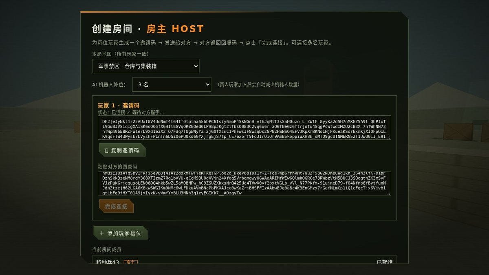

</p>

> 左：**创建房间**面板（房主生成邀请码 / 粘贴客人回复码）；右：**联机局内**，双方同处一局，右上角计分板列出真人与 AI 队友。

> ⚠️ 无内置 TURN：约 10~20% 的严格 NAT（部分移动/校园/公司网）可能握手失败，改用手机热点或双方同一 VPN 即可。

### ② 游戏内云邮箱：✉ 发信 / 收信（真·云端，离线可收）

大厅右上角 **✉** 按钮 = 云端邮箱。首次打开设定一个 **3~20 位小写地址**（`a-z 0-9 _`，例如 `abc_123`），此后其他玩家向这个地址发信就能送达——**对方不在线也会存着，下次上线实时推送**。

| 功能 | 说明 |
|---|---|
| 地址 | 首次登录自选，`^[a-z0-9_]{3,20}$`，绑定本机匿名身份，不可更改 |
| 未读角标 | ✉ 右上角红点显示未读数，`onSnapshot` **实时更新**（不用刷新页面） |
| 三个页签 | **收件箱 / 已发送 / 写邮件** |
| 读信 | 点开即标记已读（红点立即回落），可「删除此邮件」 |
| 已发送 | 存本机（`localStorage`），可随时查看自己发过什么 |
| 后端 | Firebase 匿名登录 + Cloud Firestore（SDK 已内嵌仓库，玩家**无需注册、无需配置**） |
| 限制 | 标题 ≤100 字、正文 ≤2000 字；收件箱仅本人可读/删；投递校验发件人身份 |

<p>
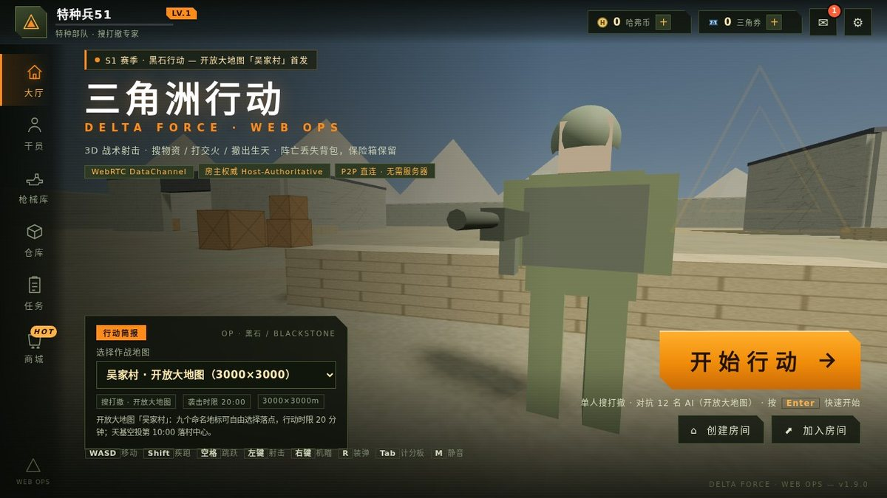
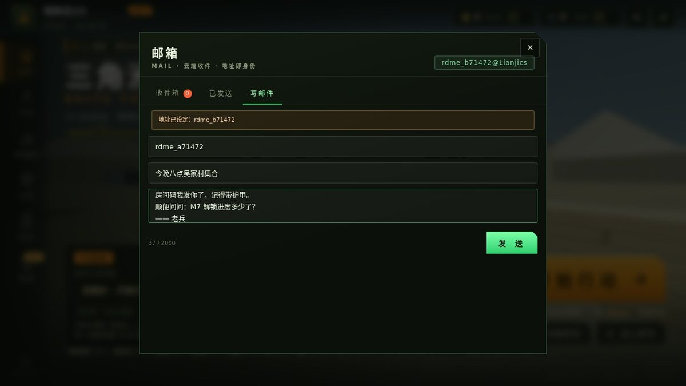
</p>

<p>
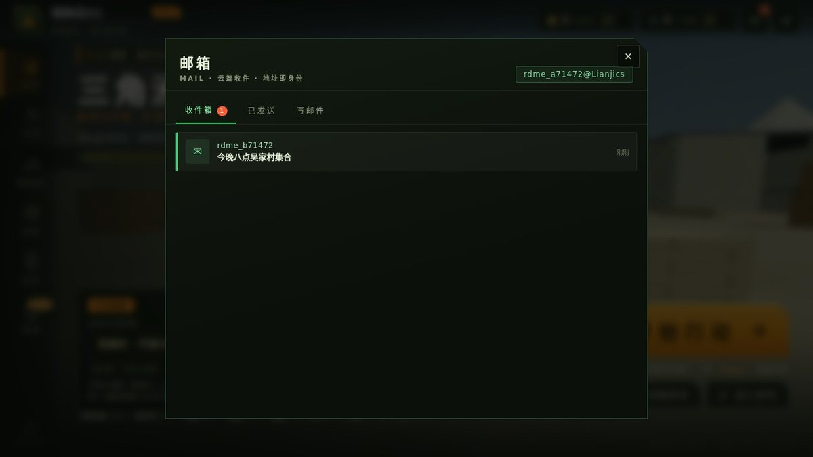
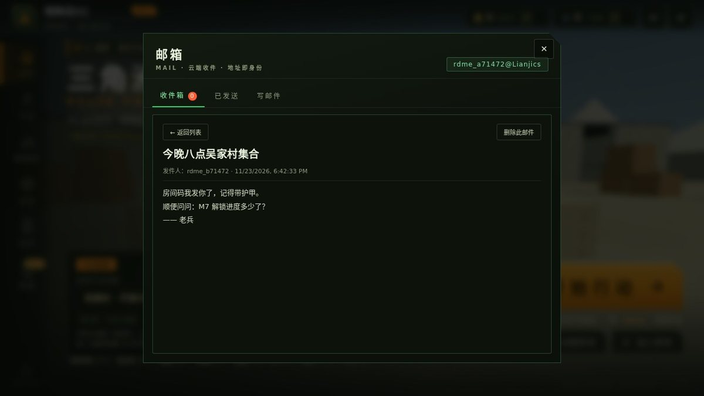
</p>

> 左上：大厅 ✉ 角标亮红点表示有未读；右上：**写邮件**（收件人地址 / 标题 / 正文 2000 字计数）。
> 左下：**收件箱** 未读列表；右下：**阅读邮件**，点开即标记已读，可一键删除。

**30 秒上手邮箱：**
1. 打开线上页面 → 点右上角 **✉** → 输入地址（如 `shuaige_01`）→ 确定
2. 把地址告诉朋友；朋友在 **✉ → 写邮件** 里填你的地址 + 标题 + 正文 → 发送
3. 你这边 ✉ 角标立刻亮红点 → 点开收件箱 → 读信 → 删除

> 身份说明：用的是 **Firebase 匿名账号**，因此换设备 / 清理浏览器缓存后地址会丢失（地址不跨设备同步）。这是匿名方案的取舍——不用注册、不用密码，代价是没有账号找回。

### ③ 商城：分类页签 + 双货币结算 + 真实生效的外观（v1.10.0）

商城重做成**五个分类页签 + 右侧详情面板**：**精选 / 武器涂装 / 外观 / 干员 / 补给**，共 15 件商品。每件商品同时标价 **三角券** 与 **哈弗币**，两种钱都能买（汇率 **1 三角券 = 260 哈弗币**）——搜刮撤离赚来的哈弗币不再是摆设。

| 分类 | 内容 | 生效方式 |
|---|---|---|
| **武器涂装**（9） | M4A1「沙暴」/ AK-74M「余烬」/ MP5「雨林」/ AWM「极地」/ M7「黑曜」/ PKM「焦土」/ M82A1「沙丘」/ SKS「琥珀」/ VSS「幽灵」 | 购买后**出战该枪自动换色**（机匣/护木/枪托/弹匣整枪调色，瞄具镜片不动），联机同款 |
| **外观**（4） | 头像框「吴家村守望者」/「黑石铁壁」/「撤离专家」、呼号特效「鎏金」 | 顶部头像框光环立即更换，可在详情面板随时**重新装备**；鎏金让呼号变色发光 |
| **干员**（1） | 干员「莽兽」档案 | 购买即永久解锁出战（干员页可选） |
| **补给**（1） | 扩容保险箱 +1 格（上限 +2） | 阵亡也能多保住一格物资 |

<p>
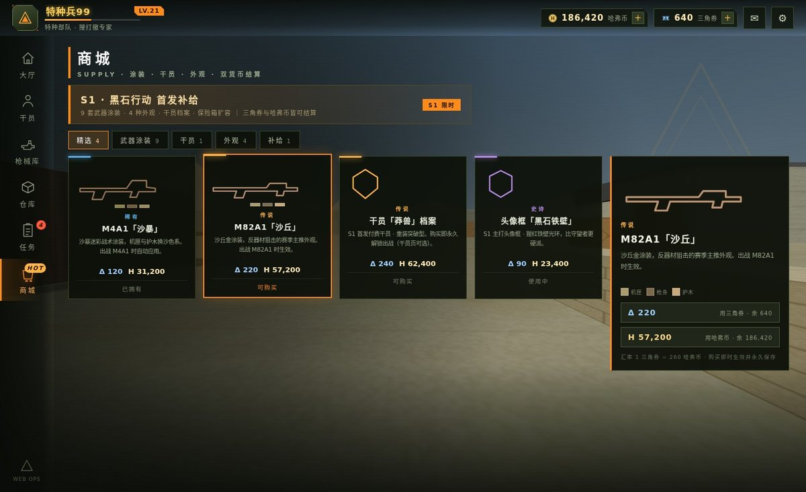
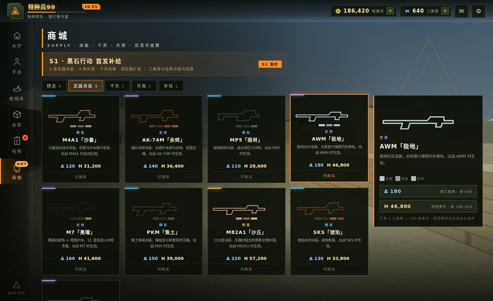
</p>

<p>
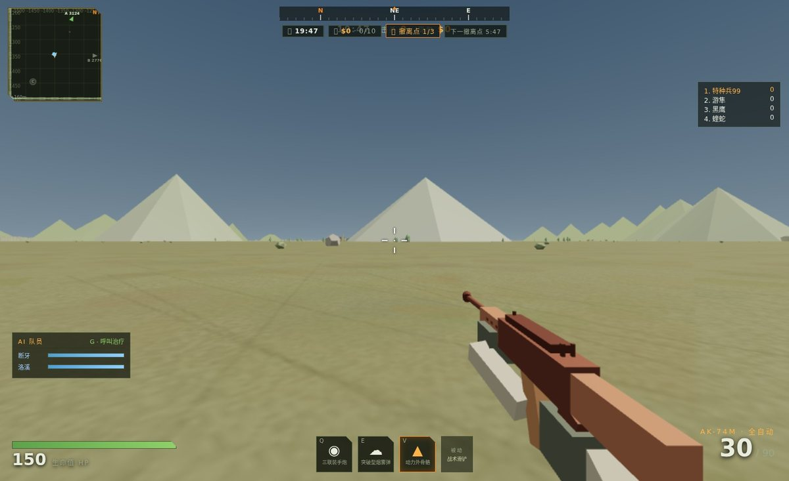
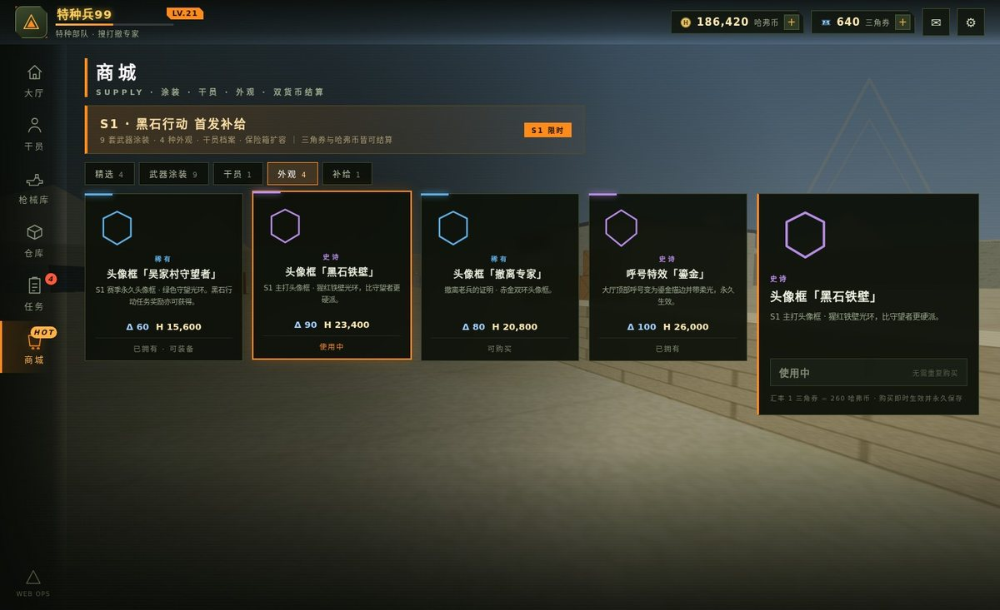
</p>

> 左上：**精选**页（稀有度色条 + 详情面板里的「三角券 / 哈弗币」两个结算按钮）；右上：**武器涂装**页。
> 左下：买完「余烬」后**局内第一人称枪模真的变红褐**（实时渲染，不是贴图）；右下：**外观**页的头像框 / 呼号特效。

**细节：**
- 稀有度分 **普通 / 稀有 / 史诗 / 传说**，卡片左上角色条带光晕
- 余额不足会明确提示还差多少（哈弗币提示「撤离带出物资可获得」）
- 所有购买 **钱货两讫、即时生效、刷新不丢**；同一件外观不会重复扣费
- 头像框可自由切换（已购即永久持有，切回不花钱）；涂装一枪一套、拥有即自动应用

### ④ 3D 物资与容器模型：每件战利品都有自己的模型（v1.11.0）

原先容器只是一个方块、战利品只是界面里的小色块。现在 **9 种战利品 + 4 种容器全部是程序化建模的低多边形模型**（零外部资源，单文件分发不受影响）：

- **战利品**：5.56 弹药箱（铁皮箱 + 黄铜弹链）· 急救绷带（纱布卷 + 红十字急救包）· 战术头盔（盔壳 + 夜视底座 + 侧轨 + 下颌带）· 防弹衣（前插板 + 弹匣包 + 肩带快拆扣）· 全息瞄准镜（镜筒 + 遮光罩 + 红点 + 导轨夹）· 显卡（双风扇 + 散热鳍片 + 金手指 + 挡板）· 金条（双层倒角 + 钢印）· 情报硬盘（盘体 + 标签 + 接口）· 机密核心（能量柱 + 三能量环 + 护笼）
- **容器**：木箱（木板 + 铁包角 + 印字）· 储物柜（双门 + 百叶 + 把手 + 锁）· 保险箱（转盘 + 刻度 + 铰链 + 拉手 + 地脚）· 空投箱（钢箱 + 黄带 + 信号灯 + 降落伞 + 烟雾）

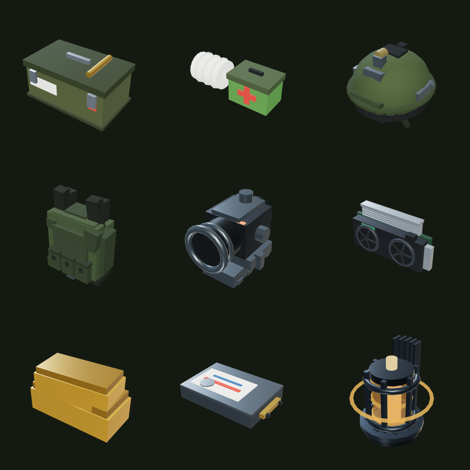

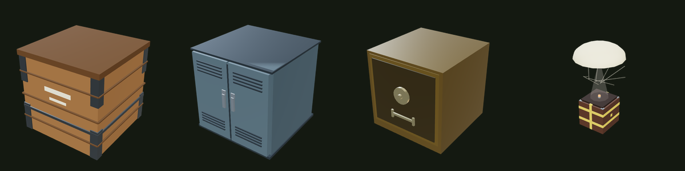

<p>
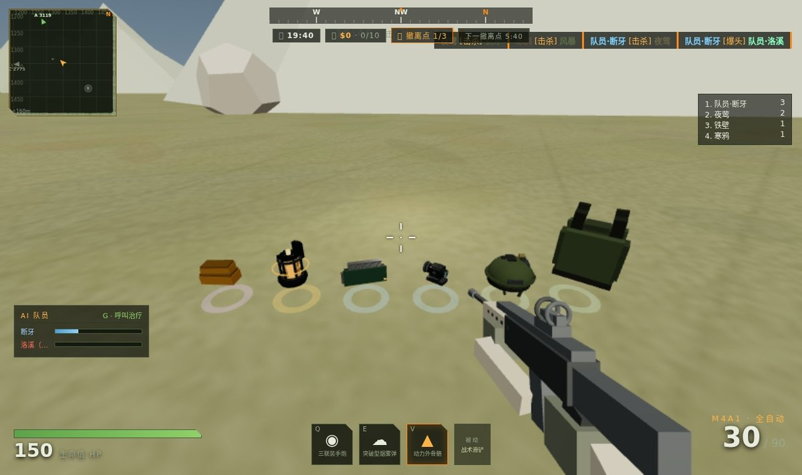
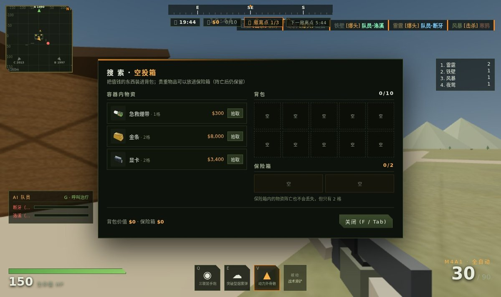
</p>

> 左下：搜完容器后，**物资会以 3D 模型 + 稀有度光环浮现在容器前**，旋转、轻微上下浮动，拾取后模型即刻消失；右下：搜刮/背包界面里的小图标也是**同一个 3D 模型离屏渲染**出来的，不是贴图。

**技术细节：**
- 全部程序化生成（`src/13_models.js`），无任何模型文件；材质做 sRGB→线性转换，避免发灰
- 静态合批：每个容器的零件合并成 **4~8 个 mesh**（原本 25 个零件），大幅降低 draw call
- 图标走离屏渲染（PMREM 摄影棚环境 + 三向布光）并缓存，**首次渲染一次，之后直接复用**
- 容器碰撞体尺寸与原版一致，模型尺寸严格贴合 `CONTAINER_TYPES`

### ⑤ 干员与敌人的 3D 士兵模型（v1.12.0）

之前场上的角色只是「几块方块拼起来的小人」——一个躯干、一颗头、两条腿。现在换成**程序化生成的战术士兵模型**，每个角色 **33 个 mesh**（全部由 `src/13_models.js` 的合批器按材质合并，零件数约 80 个）：

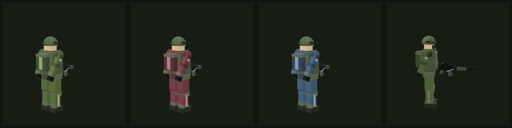

<p>
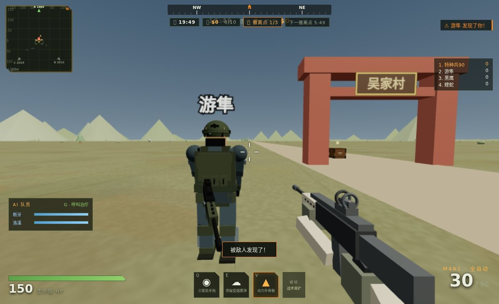
</p>

- **头部**：头盔半球 + 盔沿 + 队色盔顶标 + 夜视仪底座与镜筒 + 两侧导轨 + 头盔灯；防护目镜（深蓝镜片）+ 镜带；面部戴面罩
- **躯干**：胸腔 + 骨盆 + 腰带（腰包 ×2）；战术背心含**前后插板 + 侧围 + 弹匣包 ×3（黑色搭扣）**、电台 + 天线、医疗包、肩带 ×2、背包（顶盖 + **队色识别条**）
- **四肢**：护肩球 + 队色臂章；上臂 / 肘 / 小臂 / 护腕 / 手套 / 队色臂环；大腿（裤缝）/ 护膝 / 小腿（绑腿）/ 队色侧条 / 战术靴（含靴尖）；髋、肩各自独立枢轴，跑动摆动与蹲伏、死亡倒地全部照旧生效
- **武器**：机匣 + 上导轨 + 护木（4 条导轨齿）+ 枪管 + 消焰器 + 弹匣 + 握把 + 枪托 + 瞄具（镜片）+ 前准星 + 队色枪带，斜挎在胸前
- **队色可辨**：制服 / 护肩 / 臂章 / 盔顶标 / 背包识别条 / 枪带统一取队伍色，绿、褐、蓝三队远处一眼可分
- 性能不变：`perf_probe` 局内 mesh 数与旧版持平，fps 无回归；顺带修掉「自己中弹时血雾糊满屏幕」的旧问题（命中点贴相机时不再生成血雾）

**技术细节：**
- `DF.makeCharacter()` 整体重写（`src/02_entities.js`），`userData` 暴露 `body/legL/legR/armL/armR/gun/label` 并保留 `head/torso` 别名，旧调用方零改动
- 六个静态组各自 `DF.Models.merge()` 合批，玩家再多也不炸 draw call
- 全部材质走 `convertSRGBToLinear()`，避免 r128 下模型发灰发白
- 姿态基线写进 `armLBase/armRBase/gunBaseX`，`DF.updateCharacter()` 在基线之上叠加走路摆动与俯仰，动画与站姿不再互相覆盖

### ⑥ S2 赛季「赤砂行动」：两种新物资 + 三条赛季任务（v2.1）

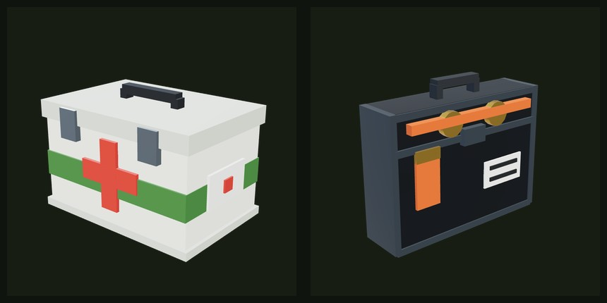

- **战术医疗箱**（少见 · 绿 · $1,600）：程序化模型含箱盖、绿色识别腰线、正反双面红十字、双锁扣、提手、侧面标签与铰链；拾取即回 **80 生命**，也可在背包里主动使用
- **加密公文包**（史诗 · 紫 · $9,800）：硬壳立式箱体 + 上下左右金属包边 + 双密码转盘与锁扣 + 一次性封条与铅封 + 正面档案标签 + 赛季橙色识别条（正反两面都有细节，模型局内旋转时两面都好看）
- 两件都进了容器产出池（`medkit` 权重 12 / `case` 权重 3），并自动获得**地面 3D 模型 + 稀有度光环**、背包/搜刮界面的**离屏渲染图标**
- **三条 S2 赛季任务**（大厅 → 任务页，可领奖）：
  - ✚ 赤砂救援：累计治疗 200 点生命 → 2,500 哈弗币 + 12 三角券
  - ▤ 情报买卖：累计带出 5 件史诗及以上物资 → 6,000 哈弗币 + 25 三角券
  - ✦ 赤砂老兵：累计击杀 60 名敌人 → 8,000 哈弗币 + 40 三角券
- 任务进度是**真实统计**（新档案字段 `healed` / `epicExtracted`）：拾取回血、主动使用医疗物资、撤离时清点背包+保险箱里价值 ≥6000 的物资，都会即时记入
- 大厅赛季横幅与商城横幅同步换成 **S2 · 赤砂行动**

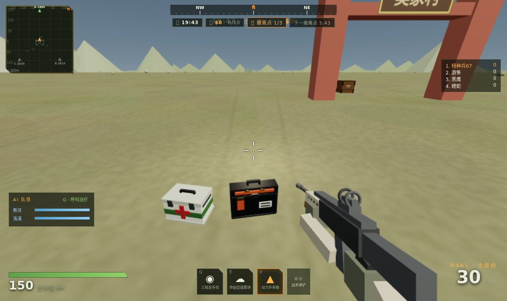

### ⑦ 第三人称视角（v2.2）

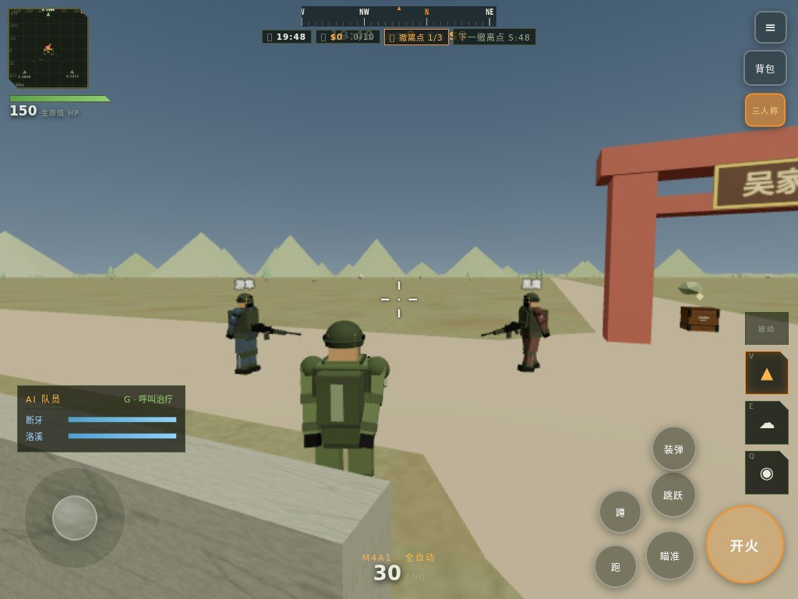

- **P 键**（触屏右上角「第一称 / 三人称」按钮，或暂停菜单里的「视角：第一人称/第三人称」）随时切换，选择记进本机存档，下次进局保持
- 第三人称相机：角色身后 **3.25m**、偏右肩 **0.6m**、高出发际 **0.56m**，肩后视角不挡准星；自身角色模型显示（第一人称自动隐藏）
- **贴墙不穿模**：每帧从眼点向机位打一条世界射线，撞墙就把相机拉近（最小 0.5m），永远不会卡进墙里
- **瞄准（ADS）** 时相机自动拉近到 **1.55m** 并居中偏肩，FOV 收到 64°（第一人称仍是 58°），散布/后坐力规则完全不变
- **弹道对齐准星**：先用相机射线找到准星真正指向的点（含敌人命中盒），再从**角色眼点**朝该点射击——近距离目标也不会因为肩部偏移打空；客人端同样生效（发送的弹道与本地预测一致）
- 跑动、蹲下、跳跃、载具（载具仍用固定机位）、死亡镜头、击杀播报、AI 行为、联机同步全部不受影响

---

## 一、怎么玩

### 打开方式（任选其一）
| 方式 | 说明 |
|---|---|
| **双击 `index.html`** | 单文件离线运行，Three.js 已内嵌，无需联网、无需服务器 |
| **本地服务器** | `cd delta && python3 -m http.server 8000`，浏览器访问 `http://localhost:8000` |
| **在线预览** | 工作区已启动预览服务（端口 8000） |

> 推荐 Chrome / Edge（WebGL2 + WebRTC 支持最好）。若显卡较弱，游戏会自动降低画质。

### 三种模式
1. **单人训练** — 你 + 7 名 AI 特种兵，无限练习，适合熟悉地图与手感。
2. **创建房间（房主）** — 生成邀请码，把朋友拉进来一起打（可留 AI 机器人补位）。
3. **加入房间（客人）** — 粘贴房主的邀请码，生成回复码发回，即可进入战场。

**胜负条件：** 不再比击杀数——**活着带物资撤离才算赢**。阵亡立即结束本局（不重生）。

---

## 二、操作

| 按键 | 功能 | 按键 | 功能 |
|---|---|---|---|
| `W A S D` | 移动 | `鼠标左键` | 射击（全自动） |
| `鼠标移动` | 视角 | `鼠标右键` | 机瞄 ADS（FOV 拉近、散布减小） |
| `Shift` | 疾跑 | `R` | 换弹 |
| `空格` | 跳跃 | `Ctrl` / `C` | 蹲下（更精准） |
| `Tab` | 计分板（按住） | `T` | 聊天 |
| `P` | **切换第一/第三人称视角** | `右键`（第三人称） | 拉近肩后相机 + 减小散布 |
| `Esc` | 暂停 / 释放鼠标 | `M` | 静音 |
| `Q` / `E` | 干员战术技能 | `V` | 干员终极技能 |
| `G` | 呼叫 AI 队友治疗 | `Ctrl` / `C`（疾跑中） | 红狼·战术滑铲 |
| 触屏 | 见下方「手机触控」专章 | | |

> 如果浏览器不允许锁定鼠标（例如嵌入预览框内），会自动切换为**按住左键拖动转视角**模式，并在暂停面板提示。

---

## 三、手机触控（已完整适配）

在手机/平板上打开（或首次触摸屏幕）会自动切到触屏模式，**建议横屏**。

| 操作 | 方式 |
|---|---|
| **移动** | 左下摇杆。整个左下区域都能起手，摇杆会跟随手指出现；**轻推＝走、推到底＝自动疾跑** |
| **转视角** | 右半屏任意位置滑动，**严格 1:1 线性**：滑右=向右转、滑左=向左转、滑上=抬头、滑下=低头。无加速度、无曲线、无反向 |
| **开火** | 右下大圆键，**按住即全自动连射**，松开停火 |
| **瞄准** | 「瞄准」键切换开镜（再按一次取消），开镜后 FOV 拉近、散布收紧 |
| **跳跃 / 装弹 / 蹲** | 对应圆键；蹲为开关式，蹲下更精准 |
| **跑** | 「跑」键为疾跑开关（配合摇杆前推） |
| **暂停** | 右上角「≡」按钮 |
| **反馈** | 命中/被击中时手机会短震动（支持的设备） |
| **灵敏度** | 主菜单内有「触屏视角灵敏度」滑杆（0.56×～1.58×），会记住设置 |

**细节适配：**
- **横屏引导**：竖屏进入战斗时会显示「请横屏游玩」，并提供「强制全屏并继续」（尝试锁定横屏，部分浏览器不支持则仅全屏）。转回横屏自动恢复。
- **HUD 重排**：小地图、血条、弹药、击杀播报位置为触屏单独布局，互不重叠，且不会被摇杆或按钮压住。
- **枪身收位**：手机横屏是 2:1 以上超宽画幅，视图模型会自动缩小并向画面中心收，保证枪身完整可见、不挡准星。
- **自适应画质**：移动端默认限制渲染比，帧率不足时自动关阴影、降内部渲染分辨率（用 CSS 拉伸铺满，避免移动端合成黑屏）。
- **安全区**：所有按键使用 `env(safe-area-inset-*)`，适配刘海屏与手势条。
- **防误触**：禁用双指缩放、双击放大、长按菜单；触摸事件全部 `preventDefault` 并带 `touch-action:none`。
- **桌面不受影响**：触屏 UI 只在检测到触摸设备（或首次触摸）时出现，键盘鼠标照常可用。

> 快速试玩：在桌面浏览器按 F12 → 设备模拟（iPhone/Pixel）刷新页面，即可用鼠标拖拽体验触控布局。

---

## 四、联机怎么连（重点）

本游戏**没有中央服务器**，用压缩后的 SDP 邀请码和回复码完成点对点握手，任意一方都能当房主。邀请码长度会因网络环境而变化；若要使用几位数字的房间码，需要另设信令服务器。双方建议使用最新版游戏和 Chrome / Edge。新版可读取旧版 DF1 邀请码，但旧版无法读取新版 DF2 码。

**步骤：**
1. **房主**：主菜单 →「创建房间」→ 点「＋ 添加玩家槽位」→ 等待状态变成「邀请码已生成」→ 点「复制邀请码」→ 用微信/QQ 发给朋友。
2. **朋友（客人）**：主菜单 →「加入房间」→ 把邀请码粘到「① 房主的邀请码」→ 点「生成回复码」→ 把生成的回复码复制发回房主。
3. **房主**：把回复码粘到对应槽位的「粘贴对方的回复码」→ 点「完成连接」。
4. 双方状态变为「已连接」后，房主点「▶ 开始战斗」即可开打。**每多一位玩家就多加一个槽位**，最多 6 名真人。

**关于网络：**
- 同一局域网 / 家庭宽带一般可直接连通（已配置 Google STUN 服务器）。
- 若一方 NAT 严格（公司网、校园网、部分移动网络），可能握手失败，此时建议：改用手机热点、双方都开同一 VPN、或使用支持 TURN 的网络环境。
- 连接为 **P2P 直连**，不经任何第三方服务器，延迟通常低于常规联机游戏。

---

## 五、网络架构说明（开发者向）

```
客人浏览器 ──输入 30Hz──▶ 房主浏览器（权威模拟）
    ▲                        │
    └──── 快照 20Hz ◀─────────┘
```

### 通道设计
- 双方各自创建 **两条 DataChannel**：`-rel`（可靠、有序）与 `-fast`（无序、零重传）。
- 任意已打开的通道都能收发：关键消息（阵容、重生、聊天）走可靠通道，**快照与特效走高速通道**（丢包不阻塞，避免队头阻塞造成的卡顿）。
- 通道由双方同时创建，按标签区分，谁先打开都能通，容错性最好。

### 房主权威（host-authoritative）
房主以 20Hz 运行固定 tick：
1. 应用收到的客人输入（方向/跳跃/蹲/瞄准/开火），推进所有远程玩家与 AI 的物理模拟；
2. **所有命中判定、伤害、击杀、重生、胜负全部由房主计算**，客户端无法自行造成伤害；
3. 每 tick 广播一份快照：`[id, x, y, z, yaw, pitch, hp, flags, kills, deaths, ammo, reserve]`。

### 防作弊措施
- 客人上报的枪口位置若偏离房主认定的玩家位置超过 2m → 强制使用房主坐标；
- 客人上报的弹道方向若与房主记录的朝向夹角过大（点积 < 0.5）→ 强制使用房主朝向；
- 射速、弹药、换弹均由房主校验（超出合法射速的射击被丢弃）；
- 血量只有房主能修改，客人收到的 `hp` 消息仅用于显示。

### 客户端预测与平滑
- 客人本地立即执行移动物理（不等待服务器），再由快照做**位置纠偏**：偏差 >2m 直接吸附，<2m 缓慢插值，避免橡皮筋；
- 其他玩家位置以 13/s 的插值速率平滑逼近平滑目标（含蹲/跑/瞄准状态位）；
- 本地射击立即播放曳光与火光，命中结果以房主广播为准。

### 快照格式（紧凑数组，省带宽）
`S: { t:'S', p:[[id,x,y,z,yaw,pitch,hp,flags,k,d,ammo,reserve],...], tl:剩余秒, st:[[id,name,color,k,d,bot],...] }`
`flags` 位域：bit0 存活 / bit1 蹲 / bit2 疾跑 / bit3 瞄准 / bit4 换弹 / bit5 离地。

---

## 六、搜打撤玩法（核心）

一局 = 一次「行动」（Raid），标准 12 分钟；开放大地图「吴家村」为 20 分钟。

### 循环
**搜物资 → 打交火 → 撤出生天**

1. **搜**：地图上散布 **27 个可搜索容器**（木箱 / 储物柜 / 保险箱 / 空投），未搜过的会在场景里显示黄色菱形标记，小地图上也会标出。走近按 **F** 开始搜索，搜索有时间（木箱 1.6s、储物柜 2s、保险箱 3s、空投 3.2s）。
2. **打**：搜刮会暴露位置，其他玩家和 AI 都会来抢。击杀敌人不加分，**唯一目标是活着带着物资离开**。
3. **撤**：跑到撤离点站住 **10 秒** 即可撤离。撤离点**延时分批开放**，且**撤离时全图广播**——所有人都会知道你正在撤离。

### 撤离点（硬核节奏）

| 撤离点 | 位置 | 开放时间 | 说明 |
|---|---|---|---|
| A 北部撤离点 | 地图北侧 (0, −78) | **开局即可用** | 最安全，但所有人都会抢 |
| B 东南撤离点 | (72, 66) | 第 **2:30** | 中期出口 |
| C 西南撤离点 | (−72, 70) | 第 **5:00** | 后期出口，走错就没时间了 |

> 开放大地图「吴家村」的撤离点拉到了地图边缘：A (0, −1465) 开局即开放（机场以北） / B (1425, 1425) 第 6:00 / C (−1425, 1445) 第 12:00；空投第 10:00 落点为吴家村村中心。

- 未开放的撤离点**站上去也不会撤离**，会提示还需等待多久
- 站进圈内全图广播 `⚠ XX 有人正在撤离！`，并播放警示音
- 撤离**必须原地站住 10 秒**，离圈即进度清零——被人打断就前功尽弃

### 物资与价值

| 稀有度 | 物资 | 价值 | 占格 | 效果 |
|---|---|---|---|---|
| 白（常见） | 5.56 弹药箱 / 急救绷带 | $220 / $300 | 2 / 1 | 绷带可回 50 HP |
| 绿（少见） | 战术头盔 / 防弹衣 | $900 / $1,250 | 3 / 4 | 头盔减伤 18%、防弹衣 22% |
| 蓝（稀有） | 全息瞄准镜 / 显卡 | $2,200 / $3,400 | 2 / 2 | 瞄具降低散布 |
| 紫（史诗） | 情报硬盘 / 金条 | $6,000 / $8,000 | 1 / 2 | — |
| 橙（传说） | 机密核心 | $18,000 | 2 | 只在空投/保险箱出 |

- **背包 10 格**（按物资占格计算，不是件数），装满就得做取舍
- **保险箱 2 格**：放进去的物资**阵亡也不会丢**，是低风险保底
- **空投**：第 **5:00** 在地图中央投放，必出高价值物资，是全图最危险的争夺点

### 死亡与结算

- **阵亡 = 背包物资全丢**，本局结束，不重生（标准撤离制）
- **保险箱内的物资保留**并计入总资产
- **超时未撤离** = 撤离失败，同样丢失背包（保险箱保留）
- 成功撤离：背包 + 保险箱价值全部计入总资产

### 战术档案（持久化）

主菜单显示累计战绩（存 `localStorage`，刷新不丢）：

- **总资产**：所有行动累计带出的资金
- **成功撤离 / 阵亡** 次数
- **最高单局**收益

> 资产目前仅做成就展示，不参与配装（按你的选择）。后续可扩展为「用钱买装备进场」。

### 操作补充

| 按键 | 功能 |
|---|---|
| **F** | 搜索附近容器 / 关闭面板 |
| **Tab** | 打开背包（拾取界面）；非战斗时按住看计分板 |
| 点击背包格子 | 使用 / 放入保险箱 / 丢弃 |
| 触屏 | 靠近容器后点击「搜索」；点击物资拾取，可通过右上角「背包」查看物品并操作保险箱；打开面板不会暂停战局 |

---

### 随机背景音乐

将 `1.mp3` 和 `2.mp3` 与 `index.html` 放在同一目录并一起部署到 GitHub Pages。用户首次点击、触摸或按键后自动开始随机播放，两首歌曲播放结束后随机选择下一首，菜单与战斗之间不中断。浏览器可能限制未交互时的有声自动播放；电脑按 M 可同时静音音乐和音效。音乐文件需要自行提供，未随游戏附带；缺少其中一首时会尝试播放另一首。

## 七、玩法内容

- **地图选择**：主菜单选择单人地图；创建房间后由房主选择，开局时同步所有玩家。可选「军事禁区」「边境前哨」「沙漠油田」「废弃城区」「临海港口」，以及新增的「吴家村 · 开放大地图」。所有地图都支持搜刮与撤离，联机双方均需使用新版游戏。

- **开放大地图 · 吴家村**（`frontier`）：**3000×3000m** 大尺寸开放战场，突破原有 176×176m 限制。参考《三角洲行动》长弓溪谷式布局，落点均为命名地标：
  - **吴家村**（地图中心）：民居群、祠堂、八角井、院墙与北入口牌坊——空投第 10:00 落在村中心；
  - **北部机场**（z≈-1150）：120m 跑道（残骸客机停在上面）、两座可进入机库、控制塔台，南北干道贯通；
  - **河畔集市**（西，河东岸）：集市建筑、开放广场与两排货摊；
  - **废弃军事基地**（东，x≈980）：两座可进入营房、哨塔、半埋式混凝土掩体、废弃坦克、沙袋阵地；
  - **西南工业区**（西南）：两座厂房、四座储油罐、两根烟囱、集装箱堆场、输油管；
  - **高岭村**（东北）：新增村落地标｜**边境哨站**（西北）：营房 + 哨塔｜**东南物流站**：厂房 + 储罐 + 货柜堆｜**南郊村落**（最南）；
  - 另有河道（西侧斜穿 ±1500m）、**桥**（东西干道跨处）、三条贯通公路、26 片松林（实例化渲染）、**实体山体**（大沟顶/黑风山/白云顶三座命名大山 + 边缘实体环山 + 远景天际线，全部带圆形碰撞）与天然陡岩边界；灌木可穿过（不挡路），其余大型可见物（山体/岩石/树木/建筑）均为实体；天空与阴影太阳跟随玩家，小地图为本人 ±160m 局部缩放（场外撤离点以方向箭头标示）。
  - 20 分钟袭击时限；容器贴地标布置（机场/吴家村/集市/基地/工业区/四处新地标 + 野外零散共 36 个容器 + 1 架空投），撤离点在地图边缘（A 北部 开局即开放 / B 东南 6:00 / C 西南 12:00）。

- **地图**：军事禁区为 176×176m 的军事禁区，含大型仓库（可进入）、两层办公楼、集装箱堆场（可叠放攀爬）、木箱群、沙袋掩体线、瞭望塔、远景山脊。
- **干员（阶级 × 技能组）**：19 名可选干员，每名 **1 个被动 + 2 个战术技能（Q/E）+ 1 个终极技能（V）**，技能全部按档案真实生效：扫描标记、穿墙干扰、烟雾/毒雾、声波脉冲、地雷/捕网/声波陷阱、治疗无人机、军犬/机械蜘蛛/猎鹰随从、隐身、紧急锚点回拉、防爆盾/便携盾、肾上腺素、霜化冻结等；冷却逐档显示，Q/E/V 释放，V 为终极技能。**AI 队友**（单人/房主模式随行 2 名）：断牙（突击）与洛溪（支援），会跟随、接敌开火、包扎你（G 键呼叫，支援干员冷却 25s→12s、治疗量 ×1.5）。
- **枪械**：十二把枪——M4A1 / AK-74M / MP5（初始）+ AWM / M249 / VSS（里程碑解锁）+ **M7 战斗步枪（120 击杀）、SKS（40 击杀）、SMG-45（60 击杀）、SR-25（100 击杀）、PKM（200 击杀）、M82A1 反器材狙击步枪（吴家村撤离 5 次）**；每把枪独立射速节奏、伤害倍率与第一人称模型；五槽配件（瞄具/枪口/握把/弹匣/枪托）真实改装并实时生效。
- **伤害模型**：最大生命值 150；爆头 65、躯干 32、腿部 18。无护甲且没有回血时分别需要 3、5、9 次命中；7.5 秒未受伤后以每秒 9 点缓慢回血。
- **HUD**：小地图（障碍 + 敌我标记 + 朝向箭头）、罗盘、准星（随移动扩散）、命中标记（击杀变红）、击杀播报、血条、弹药、比分榜、受伤方位指示、屏幕血迹、阵亡倒计时、Tab 计分板、结算面板。
- **AI**：7 名机器人具备游走／追击／交战状态机，会寻路绕障、侧向走位、控制射速、换弹，命中率随距离衰减（不会瞬狙秒人）。
- **音效**：WebAudio 实时合成枪声、命中、击杀、受伤、换弹音，无需音频资源文件。

---

## 八、文件说明

| 文件 | 说明 |
|---|---|
| `index.html` | **最终成品**，单文件游戏（内嵌 Three.js r128 + 全部逻辑），可直接分发 |
| `src/00_head.html` | 界面骨架、CSS、HUD 结构 |
| `src/01_core.js` | 常量配置、程序化贴图、地图生成、AABB 碰撞（统一网格空间哈希广相位）、射线检测 |
| `src/02_entities.js` | 干员 3D 士兵模型（`DF.makeCharacter`）、第一人称枪械、特效池、命中判定（球/胶囊）、AI |
| `src/03_net.js` | WebRTC 建连、通道管理、房主 tick 循环、快照同步 |
| `src/04_game.js` | 渲染循环、输入、本地预测、HUD、菜单与房间流程 |
| `src/05_extract.js` | 搜打撤核心：物资表、容器、背包、撤离点、资产档案 |
| `src/06_extract_ui.js` | 拾取/背包界面、撤离 HUD、结算面板、档案展示 |
| `src/07_wujia_music.js` | 吴家村专属曲《十一笔》：双击主标题两次播放/暂停 |
| `src/08_lobby.js` | 三胶着行动风格大厅：标签页切换、行动简报、干员/枪械库/任务/商城静态展示 |
| `src/09_vehicle.js` | 载具系统：突击车模型、出生点、驾驶物理、上下车交互、HUD 提示 |
| `src/10_gunsmith.js` | 枪械工坊：十二把枪 × 五槽配件、实战属性结算、第一人称枪械模型与配件可视化 |
| `src/11_operators.js` | 干员技能系统：19 名干员（被动+Q/E+V）、AI 队友（断牙/洛溪）+ G 键呼叫治疗、烟雾/标记/装置/随从/HoT 等战术实体 |
| `src/13_models.js` | **3D 模型工厂**：9 种战利品 + 4 种容器的程序化模型、静态合批、离屏渲染缩略图（`DF.Models.loot / container / thumb`） |
| `src/12_mail.js` | **云邮箱**（v1.9.0）：Firebase 匿名登录 → 认领地址 → 收件箱 `onSnapshot` 实时监听 → ✉ 未读角标 / 读信 / 删除 / 写邮件 / 已发送（本机存档） |
| `src/vendor/firebase-*.js` | Firebase compat SDK 10.14.1（app/auth/firestore），构建时内联进 `index.html`，玩家无需外部网络加载 SDK |
| `assets/*` | README 配图（联机房间面板/局内、邮箱角标/写信/收件箱/阅读页、商城精选/涂装/外观页、局内涂装效果、9 种战利品模型图、4 种容器模型图、局内战利品与搜刮界面） |
| `build.js` | 打包脚本：`node build.js` → 重新生成 `index.html` |

修改源码后执行 `node build.js` 即可重新打包（无需任何 npm 依赖）。

---

## 八点五、大厅（主菜单）

2026-11 重做为**三胶着行动风格全屏大厅**：

- 全屏 3D 场景背景（底图=当前所选地图所在世界，菜单期间缓慢环绕 3D「驻村人」）
- 顶部栏：头像 / 呼号（可编辑）/ LV.24 / 哈弗币与三角券余额 / 邮件 / 设置
- **云邮箱（✉，v1.9.0）**：Firebase 匿名登录 + Cloud Firestore；首次打开设定 3-20 位小写地址（如 `abc_123`），其他玩家向该地址发信即可送达（离线可收，下次打开实时推送，✉ 角标未读数实时更新）。收件箱仅本人可读/标记/删除，投递仅登录用户可写入且校验 `from`=本人；标题 ≤100 字、正文 ≤2000 字；已发记录存本机。firebaseConfig（本来公开）与 firebase-compat SDK（本地 vendor）随仓库发布，玩家无需注册
- 左侧导航：大厅 · 干员 · 枪械库 · 仓库 · 任务 · 商城（可切换，各页有真实可点的内容）
- 大厅页：赛季横幅、S1「黑石行动」行动简报卡（随所选地图联动地图名/时限/3000×3000）、大橙色「开始行动」主按钮（Enter 快捷键）、创建/加入房间两个幽灵按钮
- 干员：19 名干员均可选择出战（属性真生效）；枪械库：12 把武器属性条与解锁条件；任务：3/4 完成可领取（toast 发奖）；商城：S1 首发补给
- 退出对局/结算返回主菜单时自动切回「大厅」标签并刷新资产档案

## 九、已完成的验证

自动化（Playwright + 真实 Chromium）双端联调已通过：

- ✅ 房主生成邀请码 → 客人回码 → 双方 `connectionState = connected`
- ✅ 客人进入战场，房主看到客人位置与本地位置误差 < 0.01m
- ✅ 客人开火 → 房主扣除弹药并同步回客人（30 → 27）
- ✅ 房主爆头击杀客人 → 客人死亡界面弹出、击杀播报双端一致
- ✅ 4 秒后客人自动重生（满血、满弹、界面恢复）
- ✅ 单人模式：命中判定（爆头/躯干）、击杀计数、换弹、自动回血、阵亡倒计时、结算与重开
- ✅ 全流程无 JS 运行时错误

触控适配回归（Playwright 模拟 iPhone 13 / Pixel 7 / iPad Mini / iPhone SE 真实触摸事件）：

- ✅ 摇杆拖动 → 角色以 7.9m/s 疾跑，松手立即停止
- ✅ 右半屏滑动 → 视角偏航/俯仰正确变化
- ✅ 「开火」长按连射（30→23），按钮高亮，松手停火
- ✅ 跳跃离地、瞄准切换（FOV 78→58）、蹲下生效、装弹触发
- ✅ 暂停按钮 → 镜头完全冻结（偏航变化 0.0000），继续后恢复正常
- ✅ 竖屏 → 引导页出现且清空开火/瞄准输入；转回横屏自动恢复，缓冲尺寸与相机 aspect 同步
- ✅ 四种机型布局零重叠、控件全部在可视区内
- ✅ **手机端作为客人联机**：位置同步、开火扣弹与房主一致、被击杀后自动重生全部正常
- ✅ 桌面端未受影响（触屏 UI 不显示，键盘鼠标正常）

搜打撤专项回归：

- ✅ 27 个容器生成、3 个撤离点（0s / 150s / 300s 分批开放）
- ✅ 搜索计时 → 容器产出物资 → 拾取入背包（格数校验）→ 放入保险箱
- ✅ 未开放撤离点正确阻止撤离（额外提示还需多久）
- ✅ 站圈 10 秒撤离成功，结算 +$440 ~ +$2,420，写入总资产与最高单局

3D 模型专项回归（Playwright 离屏渲染 + 局内实拍）：

- ✅ 干员模型 bbox 高度 2.30m（含名牌）、脚底 y≈0、双脚着地；`legL/legR/armL/armR/gun/label` 引用齐全
- ✅ 每名干员 **33 个 mesh**（重写前约 10 个，零件 ~80 个已按材质合批）
- ✅ 跑动时 `legL.rotation.x` 随速度摆动（±0.7 rad 上限），手臂在姿态基线上叠加摆动，蹲伏/死亡倒地无破面
- ✅ 局内 15 名带模型角色同时存在 → 全场 0 运行时错误、fps 无回归（`perf_probe`）
- ✅ 第一人称被击中不再出现糊屏血雾
- ✅ 阵亡：背包 −$8,220 全部丢失、保险箱 $3,400 保留入账、不再重生
- ✅ 超时未撤离 = 失败结算（背包丢失、保险箱保留）
- ✅ 资产档案持久化（`localStorage`，刷新后保留）
- ✅ 联机：手机端搜刮 → 房主权威判定撤离 → 双端结算一致
- ✅ 撤离点坐标双端同步、开放状态同步
- ✅ 出生点安全检查（修复出生在墙/平台内的问题）

方向一致性专项回归（逐项实测相机前向量）：

| 用例 | 结果 |
|---|---|
| 向右滑 200px | 前向量 fwdX=+0.68 ✅ 向右转 |
| 向左滑 200px | fwdX=−0.68 ✅ 向左转 |
| 向上滑 150px | fwdY=+0.49 ✅ 抬头 |
| 向下滑 150px | fwdY=−0.49 ✅ 低头 |
| 滑右后按前进 | 视线·移动方向点积 = 1.00 ✅ 走的方向=看的方向 |
| 摇杆右推（面朝 −Z） | velX=+5.32、velZ=0 ✅ 向右横移 |
| 敌人面朝玩家 | 模型正面朝玩家 ✅ 朝向正确 |
| 桌面鼠标右移 | fwdX=+0.64 ✅ 向右转 |
| 联机：客人滑右 | 客人 fwdX=+0.52，房主所见 fwdX=+0.52 ✅ 双端一致 |

---

## 十、已知限制

- 无内置 TURN 服务器：**对称 NAT（约 10~20% 的移动/企业网络）可能连不上**，需借助 VPN 或热点解决。若需要 100% 连通率，可自行部署 coturn 并把地址填入 `src/03_net.js` 的 `RTC_CFG.iceServers`。
- 房主权威意味着房主拥有"上帝视角"权限（可被作弊），适合朋友间对局；竞技场景需改为专用服务器权威。
- 握手采用人工复制邀请码，若希望全自动，可加一个极简 WebSocket 信令服务（交换 SDP 约 20 行代码）。
- 视觉为程序化低多边形美术风格，非写实建模。
- 资产仅为累计展示，暂无「用钱配装」的局外成长（可按需扩展）。
- 物资、容器内容在开局时由房主一次性生成，局内不再变化（除空投）。


### 吴家村专属小曲《十一笔》
累计击杀 100 名敌人后永久解锁。解锁进度保存在本机战术档案中；解锁后点击游戏右上角的音乐按钮播放/暂停。音频文件放在 `assets/wujia-village-shiyibi.mp3`。

- 第三人称视角（v2.2）：新增 TPS 模式——相机置于角色身后偏右肩（3.25m / 0.6m / 0.56m），自身角色模型显示、第一人称枪模自动隐藏；每帧世界射线做相机碰撞，贴墙自动拉近不穿模；ADS 拉近至 1.55m 且 FOV 64°；弹道改为「相机射线定位准星目标 → 从角色眼点射出」，近距离命中与第一人称一致，客人端同款；切入口：`P` 键 / 触屏「视角」按钮 / 暂停菜单按钮，选择持久化到 `df_viewmode`。
- S2 赛季「赤砂行动」（v2.1）：新增两种物资——**战术医疗箱**（$1,600 · 少见 · 拾取回 80 生命）与**加密公文包**（$9,800 · 史诗），均有全新程序化 3D 模型（箱盖/十字/锁扣/提手/铰链；金属包边/密码转盘/封条/档案标签，正反面细节齐全）、地面光环、离屏渲染图标；新增 **3 条赛季任务**（赤砂救援 / 情报买卖 / 赤砂老兵），配套真实计数 `healed`（拾取与主动使用医疗物资的**实际回复量**）与 `epicExtracted`（撤离时清点史诗及以上物资件数），可在任务页领取哈弗币 + 三角券；大厅赛季横幅与商城横幅改为 S2 · 赤砂行动。
- 版本号升到 **2.0**（v2.0）：把「3D 干员模型 + 3D 物资/容器 + 技能栏可点 + 技能栏挪右下角 + 更名三胶着行动」这一整轮打磨合并为 2.0 里程碑；`DF.VERSION = '2.0'`，界面右下与大厅版本水印同步更新。
- 技能栏移到右下角（v1.12.2）：触屏设备上技能格从屏幕正中挪到**右下角**，竖排贴在「开火」上方（Q 最靠近拇指、往上是 E / V / 被动），56px 大按钮，右手拇指一伸就够到；「装弹」上移一格让位；**iPad 1024×768 / iPad Pro 1366×1024 / iPhone 844×390 / iPhone SE 667×375 四种尺寸实测零重叠、零越界、点按全部生效**；桌面端（鼠标指针锁定 + 键盘 Q/E/V）保持居中不占右下角弹药显示。
- 技能按钮可点（v1.12.1）：修「触屏/鼠标点技能没反应」——技能栏 `#abilbar` 原来是 `pointer-events:none` 的纯展示 HUD，只有键盘 Q/E/V 能释放，iPad 上点按钮毫无响应；现在三个技能格（以及小队面板的「G · 呼叫治疗」）都能直接点按释放，按下有高亮闪烁 + 冷却扇形；同时把 `#hud` 层级提到触控层之上，避免左侧技能按钮被摇杆热区 `#joyzone` 吃掉；触屏设备上按钮放大到 54px。
- 干员与敌人的 3D 士兵模型（v1.12.0）：`DF.makeCharacter()` 重写为程序化战术士兵——头盔（盔沿 + 夜视底座与镜筒 + 侧轨 + 头盔灯）、护目镜 + 面罩、战术背心（前插板 / 背板 / 侧围 / 弹匣包 ×3 / 电台 + 天线 / 医疗包 / 肩带）、背包 + 队色识别条、护肩球 + 队色臂章、护膝与绑腿、战术靴，以及斜挎胸前的步枪（机匣 / 导轨 / 护木导轨齿 / 枪管 / 消焰器 / 弹匣 / 握把 / 枪托 / 瞄具镜片 / 队色枪带）；每个角色约 80 个零件经材质合批压到 **33 个 mesh**，跑动摆腿、蹲伏、死亡倒地、枪口跟随俯仰全部照旧；姿态基线（`armLBase/armRBase/gunBaseX`）与动画叠加解耦，修掉「动画每帧覆盖站姿」的隐患；顺带修复第一人称自己中弹时血雾糊屏。
- 3D 物资与容器模型（v1.11.0）：新增 `src/13_models.js` 程序化模型工厂——**9 种战利品**（弹药箱/绷带/头盔/防弹衣/瞄具/显卡/金条/情报硬盘/机密核心）与**4 种容器**（木箱/储物柜/保险箱/空投箱）全部换成精细低多边形模型（各 5~27 个零件：铁包角、百叶窗、保险箱转盘刻度、降落伞与绳索、显卡双风扇与金手指等）；搜完容器后物资以 **3D 模型 + 稀有度地面光环**浮现在容器前（旋转 + 浮动 + 一盏拾取补光），拾取即消失、关面板全部清理；搜刮/背包/保险箱界面里的小图标改为**同一模型的离屏渲染图**（PMREM 摄影棚环境 + 三向布光 + sRGB→线性色准，缓存复用）；静态合批把每个容器 25 个零件合并为 **4~8 个 mesh** 控制 draw call；容器碰撞体与 `CONTAINER_TYPES` 尺寸保持一致
- 商城 2.0（v1.10.0）：商城改为**五分类页签（精选 / 武器涂装 / 外观 / 干员 / 补给）+ 右侧详情面板**，商品从 4 件扩到 **15 件**；**双货币结算**——每件同时标价三角券与哈弗币（1 三角券 = 260 哈弗币），哈弗币可直接购买任意商品（原先只做战绩展示）；稀有度体系（普通/稀有/史诗/传说 + 色条光晕）；**9 套武器涂装真实生效**：涂装调色板走通用材质层，购买后出战该枪时在 `DF.syncViewModel()` 里按部位（机匣/枪身/护木/木托/胶木）替换材质，瞄具镜片与准星不受影响，联机双方同款；**外观类**：3 种头像框（吴家村守望者/黑石铁壁/撤离专家，光环颜色不同，可随时重新装备且不重复扣费）+ 呼号特效「鎏金」；旧存档 `df_frame='1'` 自动迁移为「已拥有守望者」，换框后仍可切回；购买即时生效并持久化（`df_skins` / `df_frames_owned` / `df_frame` / `df_namefx` / `df_owned_ops` / `df_profile`）
- 云邮箱（v1.9.0）：✉「邮件」按钮接入真实云端邮箱（Firebase 匿名登录 + Cloud Firestore，firebase-compat SDK 已本地 vendor，firebaseConfig 为公开配置、随仓库发布）——玩家首次打开设定 3-20 位小写地址（`a-z0-9_`，如 `abc_123`），此后向任何已设定地址发信即可送达（对方离线也可收，下次打开实时推送）；收件箱 = `handles/{地址}/inbox` 子集合，**仅本人可读/标记已读/删除**，任意登录用户可投递且规则校验 `from == 本人 uid`、`title ≤100 / body ≤2000`；入口角标（✉ 红点未读数）由 `onSnapshot` 实时更新；含「收件箱 / 已发送（本机存档）/ 写邮件」三页签，打开即标记已读，ESC/点遮罩关闭；地址不可更改、匿名账号无密码找回（换设备/清缓存身份即丢失——已知取舍），firebaseConfig 中的 `projectId` 不可删改（coffee-spark-ai-barista-4411a 项目为邮箱专用后端）
- 干员技能系统（v1.8.0）：**19 名干员全部进驻战场，技能按档案真实生效**——突击（红狼/威龙/无名/疾风/野火/莽兽）、支援（蜂医/蛊/蝶/旅人）、工程（牧羊人/乌鲁鲁/深蓝/比特/液氮）、侦察（露娜/骇爪/银翼/回响）。每名干员 1 被动 + Q/E + V；被动含：生命上限+25（莽兽）、爆炸减伤-65%（牧羊人）、背后扇形减伤（深蓝）、免疫减速（乌鲁鲁）、据枪掩护散布-35%（比特·站在己方陷阱 5m）、击倒回血/冷却清零（威龙外骨骼/红狼/疾风）、命中标记（旅人/露娜/回响/蝶）、受击移速+12%（疾风）、愈战愈强（野火）、生命体征监测（蝶：队友<30% 减伤 30%）等；战术实体（烟雾/毒雾/声波区/霜化领域/气雾针对干员均有实效）全部由权威结算：可见、可伤害、可治疗、可被随从/装置触发；**AI 队友**（单人/房主模式 2 名：断牙·突击、洛溪·支援）——跟随、接敌开火、可呼叫包扎（**G**），支援干员呼叫仅 12s CD + 治疗 ×1.5·蜂医额外 45 HP；断牙阵亡后小队面板置灰。技能栏（Q/E/V 图标+冷却扇形+终极高亮）、小队血量面板、标记透视菱形、声源方位箭头、闪白、相机震撼全部接入 HUD。
- 更多枪械（v1.8.0）：枪械库扩充至 **12 把**——新增 **M7 战斗步枪**（120 击杀）、**SKS 半自动卡宾枪**（40 击杀）、**SMG-45 冲锋枪**（60 击杀）、**SR-25 精确射手步枪**（100 击杀）、**PKM 通用机枪**（200 击杀）、**M82A1 反器材狙击步枪**（吴家村撤离 5 次）；全部带独立射速节奏（SKS/SR-25 半自动级 0.21s/0.30s、M82A1 ≈0.63s/发）与第一人称模型（含 SKS 木托蒙皮、SR-25 4倍镜长枪管、PKM 弹链盒+两脚架、M82A1 大制退器）；客人携行白名单与房主侧射速校验同步放开（房主仍只校验枪名与配件范围，客人里程碑解锁以本机档案为准）；未入库枪械按档案里程碑真解锁（击杀/吴家村撤离），自动生效，未解锁仅可预览。
- 实战接入修正（v1.8.0）：技能/被动全部挂钩权威结算——**护盾弧**（便携盾/盾击/破障/防爆套装 360°）、铁壁减伤 55%、流荧易伤 +25%、受击/使用技能加速（疾风/威龙）、外骨骼射速+32%、狩猎箭下一枪+60% 并标记、狙击隐身/静默步不可被 bot 侦测、烟雾遮蔽 bot 视线、被动命中标记、锚点强制回拉、疾风命中率大跌（干扰/弱电模式）、牧羊人爆炸减伤、瘴气区持续掉血走整点结算、低血量/击倒愈战愈强加速；客人联机 Q/E/V 经房主 `ab` 消息权威执行（房主侧防刷冷却），G 键治疗经 `heal` 消息由房主侧队友结算。

- 大厅回归（v1.4.0）：Playwright 逐标签截图（大厅/干员/枪械库/仓库/任务/商城）0 JS 错误；点击「开始行动」后 `matchRunning=true`、大厅隐藏、HUD 显示、菜单角色隐藏；撤离/房主开局链路（smoke.py / smoke2.py）全部通过，0 控制台错误
- 灌木修正（v1.4.1）：吴家村 380 株灌木的圆形碰撞体已移除，恢复可穿过；山体等大型实体不受影响
- bot 逻辑猎场（v1.5.0）：AI 全面增强——**循声猎杀**（70m 内任何枪声会被 bot 循迹 10 秒内锁定搜索，疾跑接敌）、**搜物资**（bot 会走向最近未搜容器原地翻刮 2.4s，容器会被标记「已搜」，25s 搜刮冷却，与玩家争夺物资）、**绕侧**（chase 环游更激进）、**持枪接敌疾跑**（hunt/chase 开疾跑）、**报点**（bot 首次发现本地玩家时击杀播报 ⚠ 提醒，12s 冷却）。单人/房主模式生效（房主权威），0 JS 错误
- 袭击时长再校准（v1.5.0）：吴家村 30:00 → **20:00**；空投第 **10:00** 落村中心；B 撤离点第 **6:00** 开放（原 8:20）、C 撤离点第 **12:00** 开放（原 16:40）；小地图/简报/档案文案同步
- 商城实装（v1.7.0）：四件商品全部钱货两讫且持久化——干员「莽兽 BULLET」（240 三角券，付费首发干员，购买后干员页永久解锁）、M4A1「沙暴」涂装（120 三角券，购买后 M4A1 持枪模型自动换沙暴配色）、头像框「吴家村守望者」（60 三角券，点亮大厅顶栏头像，黑石行动任务奖励亦可获）、扩容保险箱 +1 格（150 三角券，最多 +2，阵亡保留更多物资）；购买不足会提示差额；兼修复大厅列表事件重复绑定（重复扣款/重复发放风险）
- 真实进度系统（v1.7.0）：大厅「任务」由档案真实驱动——累计撤离 / 击杀 / 搜索容器 / 吴家村行动四项，完成可领取奖励（哈弗币 + 三角券，真入账、持久化、领取后徽章消失，可重复对局积累）；右上角 哈弗币 / 三角券 双货币、LV 等级与经验条全部读取档案（等级 = 1 + 累计行动经验 / 150，经验 = 对局×15 + 撤离×120 + 击杀×10 + 搜索×3）；三把未入库枪械按档案真解锁——AWM（击杀 80）、M249（击杀 150）、VSS（吴家村撤离 3 次），解锁后可出战/改装，枪械工坊与枪械库均实时显示解锁进度；Profile 新增 searched / frontierRaids / frontierExtracted / delta 计数（旧存档自动补 0）
- 第一人称枪械模型 + 配件可视化（v1.7.0）：六把枪第一人称持枪不再共用模型——机匣/护木/枪管/弹匣/枪托轮廓互异（AK 弯弹匣+木托+斜口制动器、MP5 紧凑、AWM 长枪管+4倍镜、M249 弹链盒+重管+两脚架、VSS 一体消音套筒）；**五槽配件全部可视化**：瞄具随配件更换（原厂反射/红点/全息/2倍/4倍，镜体由小到大）、枪口装置（补偿器/消焰器/制退器/消音器，消音器压制火光与枪口定位）、前握把（垂直/直角/轻型/橡胶）、弹匣（扩容 +45% 加长）、枪托（轻/重型、战术腮托、射手底板）；换弹动画与计时按武器+配件实际换弹时间；开火音色按枪型区分；ADS 改为只隐藏手部（枪身配件保持可见）；附带安全修正：本地存档未入库枪械回落 M4A1（防 localStorage 篡改）
- 枪械工坊（v1.6.0）：大厅「枪械库」改版为自由改装台——**六把枪全部开放五个配件位**（瞄具/枪口/握把/弹匣/枪托，每位 5 种选择，共 25 件配件）；改装实时预览（伤害/弹匣/换弹/据枪稳定/后坐控制/爆头伤害，正负偏移着色），自动保存到本机（localStorage `df_gm_atts` / `df_gm_equipped`）；「出战装备」切换前线用枪（M4A1/AK-74M/MP5 已入库可出战，AWM/M249/VSS 未解锁仅可预览）；**改装真实生效**——弹匣容量（扩容+50%）、换弹时间（快速弹匣 -28%）、子弹伤害倍率、据枪/ADS/移动散布、后坐力踢枪（本机预测与房主权威伤害一致，bot 保持原厂）；HUD 右下角显示「枪名 · 全自动/已改装」；**联机**：客人开局时经 `wsel` 向房主声明枪械+配件（房主白名单校验，未解锁枪不可携行），房主权威结算伤害与弹药；并修复三处联机问题：客人开局满弹匣同步（`wsel` 晚于房主 spawn，未开火过按新武器弹量满装）、无手势 `requestPointerLock` 静默吞错、ICE 瞬断双侧 12 秒宽限（房主/客人均不再被瞬时卡顿踢下线）
- 载具系统（v1.4.2）：每张地图固定出生点的轻型突击车（frontier 吴家村 1 辆 + 北部机场 1 辆，其余地图 1 辆）。靠近按 **F** 上车，**F** 下车；**W** 油门 / **S** 刹车·倒车 / **A·D** 转向；车内 HUD 显示时速；碰撞与山体/建筑一致（撞击会减速）；单人/房主可驾驶（联机客人暂不可）
